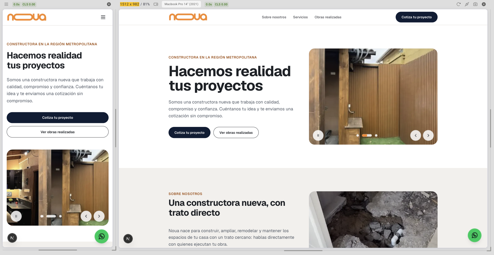

# Noua Construcción

Sitio web de **Noua Construcción**: terrazas, quinchos, piscinas, ampliaciones y remodelaciones. Hecho con **Next.js**, **TypeScript** y **Tailwind CSS**, desplegado en **Vercel**.



- Sitio: [www.noua.cl](https://www.noua.cl)
- Instagram: [@noua.contacto](https://www.instagram.com/noua.contacto/)
- Teléfono / WhatsApp: +56 9 7399 4163
- Correo: noua.contacto@gmail.com

Parte de la base [`business-web-starter`](https://github.com/Hrodrico/business-web-starter), con el historial enlazado. Para traer mejoras de la base:

```bash
git fetch base
git switch -c chore/sync-base
git merge base/main      # resolver conflictos en lo personalizado (src/sites, CI, README)
```

Luego abre un PR y fusiónalo con **Create a merge commit** (no squash ni rebase).

## Stack

- [Next.js 16](https://nextjs.org/) (App Router, Cache Components)
- [React 19](https://react.dev/) y [TypeScript](https://www.typescriptlang.org/)
- [Tailwind CSS 4](https://tailwindcss.com/)
- [Vercel](https://vercel.com/) para hosting
- Modo claro y oscuro (sigue al sistema, con botón sol/luna en el header), sin dependencias extra

Requiere **Node.js 24 LTS** (obligatorio). Con `nvm use` se activa la versión de `.nvmrc`. Con otra versión, `npm install` falla (`engine-strict` en `.npmrc`) y `dev`/`build`/`start` se detienen con un aviso.

## Desarrollo local

```bash
npm install
npm run dev        # http://localhost:3000
npm run build      # build de producción
npm run start      # sirve el build
npm run lint
```

## Tests

```bash
npm test                          # unitarios (Vitest), una pasada
npm run test:watch                # unitarios en modo watch
npx playwright install chromium   # solo la primera vez
npm run test:e2e                  # E2E (Playwright) contra el build de producción
```

- Los tests unitarios viven **junto a cada archivo** (`Rating.tsx` + `Rating.test.tsx`).
- Los E2E viven en `e2e/` y recorren el sitio en móvil y escritorio.
- `src/sites/sites.test.ts` valida el contenido del sitio: slugs, fechas, reseñas, textos `alt`, que existan las fotos y los logos, y el contraste de los colores del tema en modo claro y oscuro.
- Los tests no tienen textos del negocio escritos: leen el contenido activo, así no se rompen al cambiar textos.

### Integración continua

`.github/workflows/ci.yml` corre en GitHub Actions en cada push a `main` y en cada pull request: lint y tests unitarios, build + E2E, y al final el job **CI completo**, que solo pasa si todo lo anterior pasó. Si falla un E2E, el reporte de Playwright queda como artefacto del run.

Vercel no ejecuta los tests: solo hace el build y publica. Para que no llegue nada roto a `main` (y por tanto a producción), la rama se protege con el ruleset versionado en [`.github/rulesets/main.json`](.github/rulesets/main.json): **Settings → Rules → Rulesets → New ruleset → Import a ruleset**. Exige PR, bloquea force push y borrado, pide la rama al día y los checks **`Lint y tests unitarios`** y **`CI completo`** (que cubre el build + E2E).

## Estructura

```text
src/
  app/
    layout.tsx               Layout raíz: <html>, fuente, tema y metadatos SEO
    (site)/                  Sitio público (grupo de rutas)
      layout.tsx             Header, footer y botón de WhatsApp
      page.tsx               Home: hero + secciones activas
      trabajos/page.tsx      Listado de trabajos realizados
      trabajos/[slug]/       Detalle de un trabajo con sus reseñas
    not-found.tsx
    robots.ts, sitemap.ts
  components/
    layout/                  Header, Footer, MobileMenu, Container
    sections/                Hero, About, Services, Projects, Reviews, Contact
    ui/                      ButtonLink, Media, ThemeToggle, ImageCarousel, ImageGallery, iconos…
  lib/
    data.ts                  Capa de acceso a datos (getServices, getProjects…)
    site.ts                  Configuración del negocio activo
    contact.ts               Enlaces wa.me, tel: y mailto:
    navigation.ts            Menú derivado de las secciones activas
    theme.ts                 Colores → variables CSS y script del modo oscuro
  sites/
    index.ts                 Registro del negocio activo
    construction/            config.ts + content.ts (Noua Construcción)
  types/
    site.ts                  Contrato de configuración (SiteConfig)
    content.ts               Contrato de contenido (Project, Review, Service…)
public/
  images/projects/           Fotos de trabajos: <año>/<slug>/<foto>.webp
  images/about/              Imagen de "Sobre nosotros"
  logos/                     Logo (modo claro y oscuro) e imagen para redes
```

### Reglas de la arquitectura

- **Los componentes no conocen al negocio.** Reciben todo por props. Solo `src/app/` importa la configuración (`@/lib/site`) y los datos (`@/lib/data`).
- **El contenido se lee solo a través de `src/lib/data.ts`.** Hoy esas funciones devuelven lo que está en `src/sites/<negocio>/content.ts`. Cuando un proyecto necesite base de datos o CMS, se reescriben esas funciones (misma firma) y el resto del código no cambia.
- **Los colores se definen una sola vez** en `config.ts` y llegan a Tailwind como clases: `bg-primary`, `text-muted`, `border-border`, `bg-surface`, `text-accent`, etc. La paleta oscura (`themeDark`) usa los mismos nombres, así que esas clases cambian solas con el modo; para ajustes puntuales se usa la variante `dark:` con tokens (`dark:bg-surface`), nunca colores fijos.
- **Vocabulario genérico en el código, etiquetas en la config.** En el código se habla de `projects`, `services` y `reviews`; lo que ve el usuario sale de `labels` ("Obras realizadas", "Nuestros cortes"…).

## Editar el contenido

### 1. Configuración: `src/sites/construction/config.ts`

Nombre, descripción, dominio (`url`), idioma, contacto (teléfono, correo, WhatsApp con mensaje precargado, dirección, mapa, horarios), redes sociales, logo, colores, SEO, **secciones activas** y **etiquetas** de cada sección. El tipo `SiteConfig` marca qué es obligatorio.

**Colores y modo oscuro:** `theme` es la paleta clara y `themeDark` la oscura. Si `themeDark` existe, el sitio sigue la preferencia del sistema y muestra el botón sol/luna; la elección se guarda en el navegador y, si coincide con la del sistema, se olvida para volver a seguirlo. Cada par texto/fondo debe tener contraste de al menos 4,5:1 en ambas paletas (lo verifica `sites.test.ts`).

### 2. Contenido: `src/sites/construction/content.ts`

Hero, quiénes somos, servicios, trabajos realizados (con galería) y reseñas. Una reseña se asocia a un trabajo con `projectSlug` y aparece en su página de detalle.

### 3. Imágenes

Las fotos de obras van en una carpeta por año y por obra, con el mismo `slug` del trabajo en `content.ts`:

```text
public/images/projects/
  2026/
    remodelacion-bano-nunoa/
      antes.webp
      despues.webp
    terraza-vitacura/
      terminada.webp
```

```ts
cover: { src: "/images/projects/2026/terraza-vitacura/terminada.webp", alt: "Terraza con porcelanato tipo madera" },
```

- **Año:** el de la obra; si el trabajo tiene `date`, debe coincidir.
- **Nombre de la foto:** minúsculas, sin tildes ni espacios, y que diga qué muestra (`antes`, `despues`, `radier-abierto`).
- **Formato:** `.webp` (o `.jpg`), de unos 1600 px por lado como máximo. Con [`cwebp`](https://developers.google.com/speed/webp/docs/cwebp) (`brew install webp`): `cwebp -q 80 -resize 1600 0 -metadata none foto.jpg -o foto.webp`.
- **Al reemplazar una foto,** usa un nombre nuevo: los navegadores y la CDN guardan la anterior en caché por su URL.

`src/sites/sites.test.ts` verifica que cada foto exista y que respete esta estructura.

Mientras no haya foto, se muestra un marcador con los colores del tema. En modo oscuro las fotos se atenúan levemente para que no brillen sobre el fondo.

**Logo:** va en `public/logos/`, con fondo transparente, y se configura en `branding.logo`. Si en modo oscuro no se ve bien, agrega una versión en `branding.logoDark` (Noua usa la franja en un azul más claro). Reemplaza también `src/app/favicon.ico`.

## Cómo crecer

| Necesidad | Dónde |
| --- | --- |
| Login / panel privado | Nuevo grupo de rutas `src/app/(dashboard)/` con su propio layout, más `src/app/(auth)/login`. |
| Base de datos o CMS | Reescribir las funciones de `src/lib/data.ts`. |
| Nueva sección (ej: precios, FAQ) | Componente en `components/sections/`, tipo en `types/content.ts` y nueva clave en `sections`/`labels`. |
| Catálogo / e-commerce | Ruta `src/app/(site)/productos/` siguiendo el patrón de `trabajos/`. |
| Formulario de contacto | Server Action + servicio de correo (documentar variables en `.env.example`). |

## Despliegue en Vercel

Vercel publica cada push a `main` en producción y cada PR como vista previa.

1. Importa el repositorio en Vercel (detecta Next.js automáticamente).
2. **Dominio (`noua.cl`, registrado en [NIC Chile](https://www.nic.cl/)):**
   - En Vercel, agrega `noua.cl` y `www.noua.cl` al proyecto, con `www.noua.cl` como principal y `noua.cl` redirigiendo a él.
   - En NIC.cl, en la configuración técnica del dominio elige **Servidores DNS** e ingresa `ns1.vercel-dns.com` y `ns2.vercel-dns.com` (o los que indique Vercel).
   - Cuando Vercel muestre "Valid Configuration", el sitio queda en el dominio con HTTPS. Debe coincidir con `url` en `config.ts`.
3. **Repositorio privado en el plan Hobby:** Vercel solo publica commits cuyo autor puede verificar en GitHub. Configura en este repo el correo de tu cuenta: `git config user.email "<correo de GitHub>"`.

## Antes de publicar

- [x] `url` con el dominio real (`https://www.noua.cl`; se usa en canonical, sitemap y Open Graph).
- [ ] Teléfono, WhatsApp (con código de país), correo y redes reales; nada de datos `example.com` ni `0000`.
- [ ] Textos y reseñas reales (no publicar contenido de ejemplo como si fuera verdadero).
- [ ] Fotos con texto alternativo descriptivo, logo, favicon y `seo.ogImage`.
- [ ] Revisar en móvil, tablet y escritorio, en modo claro y oscuro.
- [ ] `npm run build` sin errores.

## Contribuir

- Flujo: rama (`feat/…`, `fix/…`, `chore/…`) → PR → CI en verde → merge a `main` con **Create a merge commit**.
- Mensajes con [Conventional Commits](https://www.conventionalcommits.org/es/): `<type>(<scope>): <qué se hizo>`, con el tipo en inglés y la descripción en español (ej. `fix(obras): evita repetir el nombre de la obra`). Detalle en `CLAUDE.md`.
- `.claude/` y `graphify-out/` son herramientas locales (Claude Code y su grafo del código) y no se versionan.

> Nota: con Cache Components, una URL de trabajo inexistente (`/trabajos/no-existe`) muestra la página 404 con `noindex`, pero responde HTTP 200 porque la página se transmite por streaming. Es el comportamiento esperado de Next.js 16.

## Licencia

Define la licencia del repositorio antes de distribuir o reutilizar públicamente el código.
